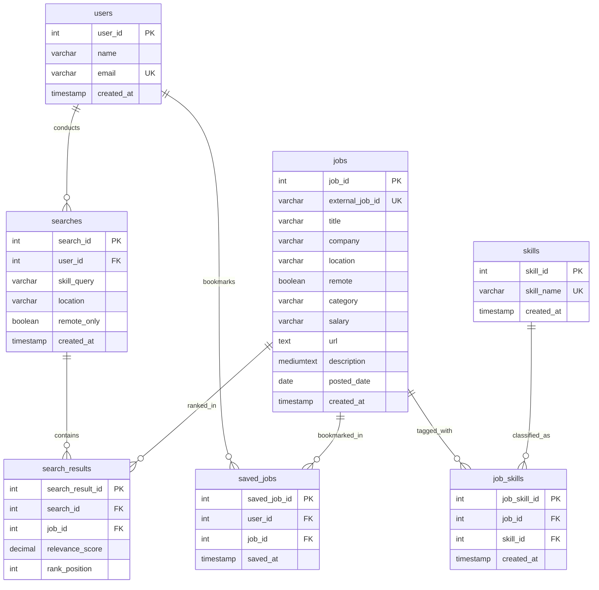

# Job Search & Recommendation App ✦

An end-to-end Job Search & Recommendation application built with **Python**, **Streamlit**, the public **Arbeitnow REST API**, and a local **MySQL Server** managed with **MySQL Workbench**.

Designed for student academic demonstrations, this application normalizes incoming vacancies from an external REST API, executes deterministic multi-attribute scoring and ranking, persists user searches and bookmarks in local MySQL relational tables, and displays live database analytics with Plotly.

---

## 📋 Table of Contents
1. [Key Features](#-key-features)
2. [Technology Stack](#-technology-stack)
3. [Project Structure](#-project-structure)
4. [Database Architecture & Schema](#-database-architecture--schema)
5. [Ranking & Scoring Methodology](#-ranking--scoring-methodology)
6. [API Integration & Geographic Coverage](#-api-integration--geographic-coverage)
7. [Step-by-Step Setup Instructions (Windows)](#-step-by-step-setup-instructions-windows)
8. [MySQL Workbench Verification Queries](#-mysql-workbench-verification-queries)
9. [Troubleshooting Guide](#-troubleshooting-guide)
10. [Running the Test Suite](#-running-the-test-suite)

---

## 🌟 Key Features

- **Candidate Profile Management**: Switch or register candidate profiles (name + email) so search history and bookmarks remain strictly associated with that profile.
- **Interactive Search with Skill Chips**: Quick-add buttons for high-demand skills (`Python`, `SQL`, `Data Analysis`, `Machine Learning`, `Power BI`, etc.), plus free-text input and preferred location.
- **Deterministic 80/20 Multi-Attribute Ranking**:
  - **80% Skill Coverage**: Boundary-aware matching (`Java` ≠ `JavaScript`, `C` ≠ `C++` / `C#`, `.NET`), alias normalization (`JS` → `JavaScript`, `ML` → `Machine Learning`), across title, tags, and description.
  - **20% Location Relevance**: 100% for direct city matches, 75% for remote accessibility, 0% for non-remote mismatches.
  - Explainable breakdown pill and details available for every ranked position.
- **In-Memory Filtering & Sorting**: Filter active results by remote status, company, or minimum relevance score without re-triggering API calls or creating duplicate database records.
- **Atomic Database Persistence**: Every search and its ranked job results are saved in a single MySQL transaction (`searches`, `jobs`, `skills`, `job_skills`, `search_results`).
- **My Searches**: View timestamped history of searches. Open past ranked results directly from MySQL with **zero API calls**, or trigger a fresh re-run.
- **Saved Jobs (Bookmarks)**: Persistent bookmarked vacancies linked to the active profile in the `saved_jobs` table.
- **Real Database Analytics**: Live aggregate metrics and Plotly charts computed directly from relational tables:
  - Total searches, unique stored jobs, total bookmarks, and remote job percentage.
  - Horizontal bar charts for top in-demand skills and top hiring companies.
  - Transparent denominators (no fake or hardcoded statistics).

---

## 🛠 Technology Stack

| Layer | Technology | Details |
| :--- | :--- | :--- |
| **Frontend** | Streamlit 1.35+ | Interactive reactive web interface with custom indigo/navy design tokens |
| **Logic & Engine** | Python 3.10+ | Pure Python modular architecture (`services/`, `database/`, `ui/`) |
| **REST API** | `requests` | Official Arbeitnow Job Board API client with bounded pagination |
| **Database** | MySQL Server 8.0+ | Local relational database using **InnoDB** with utf8mb4 encoding |
| **DB Client & Driver** | `mysql-connector-python` | Parameterized SQL queries (`%s`), transactions, rollbacks |
| **Configuration** | `python-dotenv` | Credentials managed via `.env` (never hardcoded) |
| **Data & Charts** | Plotly & Pandas | Dynamic frequency bar charts and metrics |
| **Testing** | `pytest` | Comprehensive unit tests for boundaries, weights, and mocks |

---

## 📁 Project Structure

```
job_search_app/
├── app.py                     # Main Streamlit coordinator and state router
├── services/
│   ├── __init__.py
│   ├── jobs_api.py            # Arbeitnow REST client, pagination, HTML sanitizer
│   ├── ranking.py             # Deterministic 80/20 scoring & sorting engine
│   └── skill_extraction.py    # Boundary-aware regexes and alias resolver
├── database/
│   ├── __init__.py
│   ├── connection.py          # MySQL connector, health checks, error sanitization
│   └── repository.py          # Parameterized CRUD & atomic search transactions
├── ui/
│   ├── __init__.py
│   ├── components.py          # Design system, banners, and metric cards
│   ├── search_view.py         # Search form, filters, pagination, and job cards
│   ├── history_view.py        # MySQL search history viewer and rerun trigger
│   ├── saved_jobs_view.py     # Persistent user bookmarks
│   ├── analytics_view.py      # Plotly database analytics
│   ├── profile_view.py        # Candidate profile switcher
│   └── about_view.py          # Technical documentation
├── sql/
│   ├── schema.sql             # Complete DDL script for MySQL Workbench
│   └── create_app_user.sql    # Optional least-privilege user script
├── tests/
│   ├── __init__.py
│   ├── test_skill_extraction.py # Java/JS, C/C++/C#/.NET, and alias tests
│   ├── test_ranking.py          # 80/20 weights, blank inputs, remote filter tests
│   ├── test_api.py              # HTML cleaning, missing fields, network error tests
│   └── test_database.py         # Transaction rollbacks, upserts, profile isolation tests
├── .streamlit/
│   └── config.toml            # Custom theme configuration (indigo/navy palette)
├── .env.example               # Template for database credentials
├── .env                       # Local database environment variables (not committed)
├── .gitignore                 # Prevents committing .env, caches, and bytecode
├── requirements.txt           # Project dependencies
└── README.md                  # Complete documentation and setup manual
```

---

## 🗄 Database Architecture & Schema

The schema uses **InnoDB** with `utf8mb4_unicode_ci`, Foreign Keys (`ON DELETE CASCADE`), Indexes, and Uniqueness constraints across **seven core tables**:



### Table Responsibilities
1. **`users`**: Profiles for demo candidate tracking (`user_id`, `name`, `email` UNIQUE).
2. **`searches`**: Records every distinct search execution (`search_id`, `user_id`, `skill_query`, `location`, `remote_only`).
3. **`jobs`**: Normalized job listings repository with `external_job_id` UNIQUE and upsert support (`ON DUPLICATE KEY UPDATE`).
4. **`skills`**: Master table of distinct skill strings (`skill_id`, `skill_name` UNIQUE).
5. **`job_skills`**: Many-to-many bridge linking jobs with identified skills (`UNIQUE(job_id, skill_id)`).
6. **`search_results`**: Preserves ranked scores and positions (`UNIQUE(search_id, job_id)`).
7. **`saved_jobs`**: Persistent user bookmarks (`UNIQUE(user_id, job_id)`).

---

## 📊 Ranking & Scoring Methodology

The algorithm calculates an explainable, deterministic match score without unverified AI claims:

$$\text{Overall Score} = 0.80 \times \text{Skill Score} + 0.20 \times \text{Location Score}$$

### 1. Skill Score (80% Weight)
- **Coverage**: $\frac{|\text{Matched Skills}|}{|\text{Requested Skills}|} \times 100\%$ matched against title, tags, and description.
- **Boundary-Aware Matching**:
  - `Java` does **not** match `JavaScript`.
  - Single-character `C` does **not** match `C++`, `C#`, or `CSS`.
  - Punctuation-sensitive skills (`C++`, `C#`, `.NET`, `dotnet`) are cleanly recognized.
- **Alias Resolution**: Automatically equates `JS` → `JavaScript`, `ML` → `Machine Learning`, `Postgres` → `PostgreSQL`, `TS` → `TypeScript`, etc.

### 2. Location Score (20% Weight)
- **Direct Match**: $100\%$ if the job location contains the candidate's target location.
- **Remote Role**: $75\%$ if the job is marked `remote = True`.
- **Mismatch**: $0\%$ if the role is non-remote and in a different location.

### 3. Edge Cases
- **Location Blank**: Score = $100\%$ based on Skill Coverage.
- **Skills Blank**: Score = $100\%$ based on Location Relevance.
- **Both Blank**: System displays a validation error requiring at least one input.
- **Remote Only**: Hard filter that strictly discards non-remote jobs.
- **Sorting Order**: Relevance Score (DESC) $\rightarrow$ Posted Date (DESC) $\rightarrow$ External Job ID (stable alphabetical tie-breaker).

---

## 🌐 API Integration & Geographic Coverage

- **Provider**: [Arbeitnow Job Board REST API](https://www.arbeitnow.com/api/job-board-api)
- **Geographic Scope**: Arbeitnow is an established job board focusing on **European technology hubs** (London, Berlin, Munich, Paris, Zurich) and **global Remote positions**. It does **not** index broad domestic positions for regions such as India or US domestic cities unless the posting is explicitly marked as Remote.
- **Field Handling**: Arbeitnow does not return structured salary figures; salary is truthfully reported as *"Not provided"*. No fabricated logos or fake compensation ranges are injected.
- **Caching**: API queries are cached for 15 minutes (`st.cache_data(ttl=900)`). **Database writes are never cached.**

---

## 🚀 Step-by-Step Setup Instructions (Windows)

### 1. Open PowerShell & Navigate to Project Directory
```powershell
cd "c:\Users\SINDHU SURAJ\Documents\IdeaProjects\job_search_app"
```

### 2. Create and Activate Virtual Environment
```powershell
python -m venv venv
.\venv\Scripts\Activate.ps1
```
*(If you see an execution policy restriction, run `Set-ExecutionPolicy -Scope Process -ExecutionPolicy Bypass` and re-activate).*

### 3. Install Dependencies
```powershell
pip install -r requirements.txt
```

### 4. Ensure Local MySQL Server is Running
Check Windows Services to confirm `MySQL80` (or your MySQL service) is running:
```powershell
Get-Service -Name *mysql*
```
If stopped, start it via PowerShell as Administrator:
```powershell
Start-Service -Name MySQL80
```

### 5. Open MySQL Workbench & Execute Database Schema
1. Launch **MySQL Workbench**.
2. Connect to your local MySQL instance (usually `localhost:3306`).
3. Go to **File $\rightarrow$ Open SQL Script...** and select:
   `sql/schema.sql` (or `job_search_app.sql`).
4. Click the ⚡ **Execute** button to create the database and all seven tables.

### 6. (Optional) Create Least-Privilege App User
If you prefer not to use `root` in `.env`:
1. Open `sql/create_app_user.sql` in MySQL Workbench.
2. Replace `'app_secure_password_here'` with your preferred password.
3. Click ⚡ **Execute**.

### 7. Configure Environment Variables
Copy `.env.example` to `.env`:
```powershell
Copy-Item .env.example .env
```
Open `.env` in your editor and enter your local MySQL credentials:
```env
DB_HOST=localhost
DB_PORT=3306
DB_NAME=job_search_app
DB_USER=root
DB_PASSWORD=your_actual_mysql_password
```
*(Note: If you used `sql/schema.sql`, set `DB_NAME=job_recommendation_db`. If you ran `job_search_app.sql`, set `DB_NAME=job_search_app`)*.

### 8. Launch the Streamlit App
```powershell
streamlit run app.py
```
Your default browser will open automatically at `http://localhost:8501`.

---

## 🔍 MySQL Workbench Verification Queries

Open **MySQL Workbench** while using the application to verify data persistence:

```sql
-- Select your active database
USE job_search_app; -- or: USE job_recommendation_db;

-- 1. Inspect registered candidate profiles
SELECT * FROM users;

-- 2. Inspect recorded search transactions
SELECT search_id, user_id, skill_query, location, remote_only, created_at 
FROM searches 
ORDER BY search_id DESC;

-- 3. Inspect genuine imported jobs
SELECT job_id, external_job_id, title, company, location, remote, posted_date 
FROM jobs 
ORDER BY job_id DESC 
LIMIT 10;

-- 4. Inspect normalized skills master table
SELECT * FROM skills ORDER BY skill_id DESC LIMIT 20;

-- 5. Inspect ranked search results for the most recent search
SELECT sr.rank_position, sr.relevance_score, j.title, j.company, j.location
FROM search_results sr
JOIN jobs j ON j.job_id = sr.job_id
WHERE sr.search_id = (SELECT MAX(search_id) FROM searches)
ORDER BY sr.rank_position ASC;

-- 6. Inspect persistent bookmarks (Saved Jobs)
SELECT u.name, j.title, j.company, sj.saved_at
FROM saved_jobs sj
JOIN users u ON u.user_id = sj.user_id
JOIN jobs j ON j.job_id = sj.job_id;
```

---

## 🛠 Troubleshooting Guide

| Issue | Cause | Resolution |
| :--- | :--- | :--- |
| **Can't connect to MySQL server at localhost:3306** (Error 2003) | MySQL service is stopped. | Run `Start-Service MySQL80` in PowerShell or start it via Windows Services (`services.msc`). |
| **Access Denied for user** (Error 1045) | Incorrect `DB_USER` or `DB_PASSWORD` in `.env`. | Verify your MySQL password by testing a login in MySQL Workbench, then update `.env`. |
| **Unknown database** (Error 1049) | Database hasn't been created yet. | Open `sql/schema.sql` in MySQL Workbench and click Execute (⚡). Ensure `DB_NAME` in `.env` matches. |
| **API Timeout or Network Error** | Transient network glitch or firewall restriction. | Click **"Search Local Cached Database"** to explore previously imported jobs stored in MySQL. |
| **No Indian or domestic city vacancies** | Arbeitnow is focused on Europe & Remote roles. | Select the **"Remote only"** checkbox to discover global remote tech jobs. |

---

## 🧪 Running the Test Suite

Execute the automated test suite using `pytest`:

```powershell
python -m pytest -v
```

### Test Suite Coverage
- `test_skill_extraction.py`: Boundary verification (`Java` vs `JavaScript`, `C` vs `C++`/`C#`/`CSS`, `.NET`, aliases).
- `test_ranking.py`: 80/20 weights, blank input scoring, remote-only filter, deterministic tie-breakers.
- `test_api.py`: HTML unescaping, double-entity stripping, missing field resilience, timeout/network mocks.
- `test_database.py`: Transaction rollback on mid-batch failure, `ON DUPLICATE KEY UPDATE` syntax, profile-scoped bookmarks.
